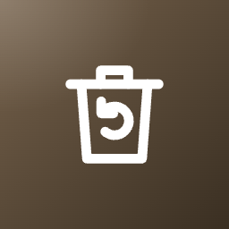
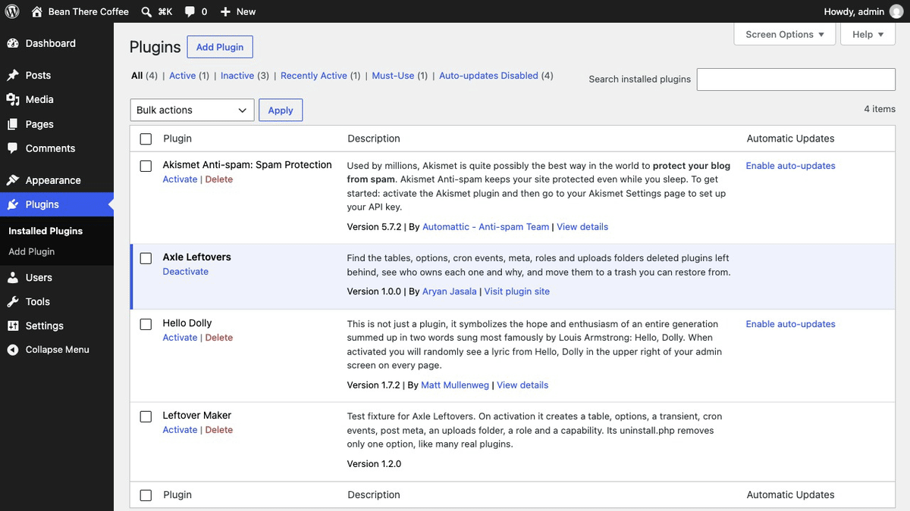
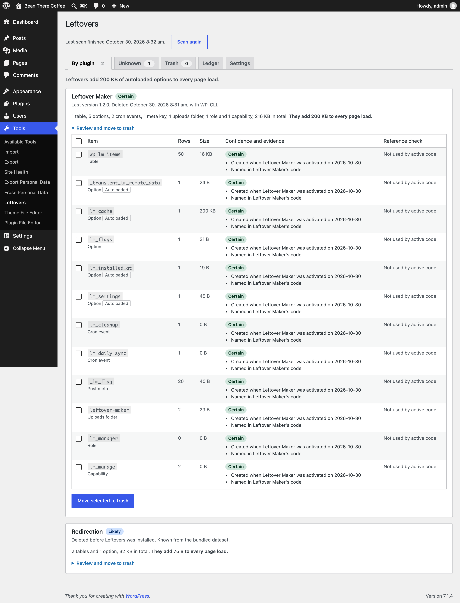
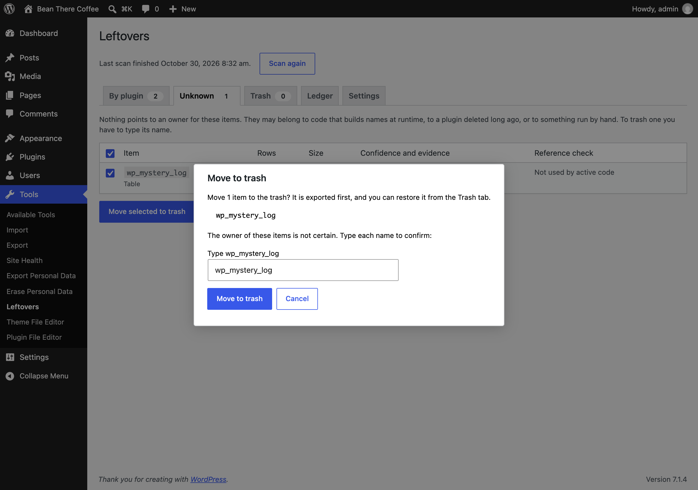
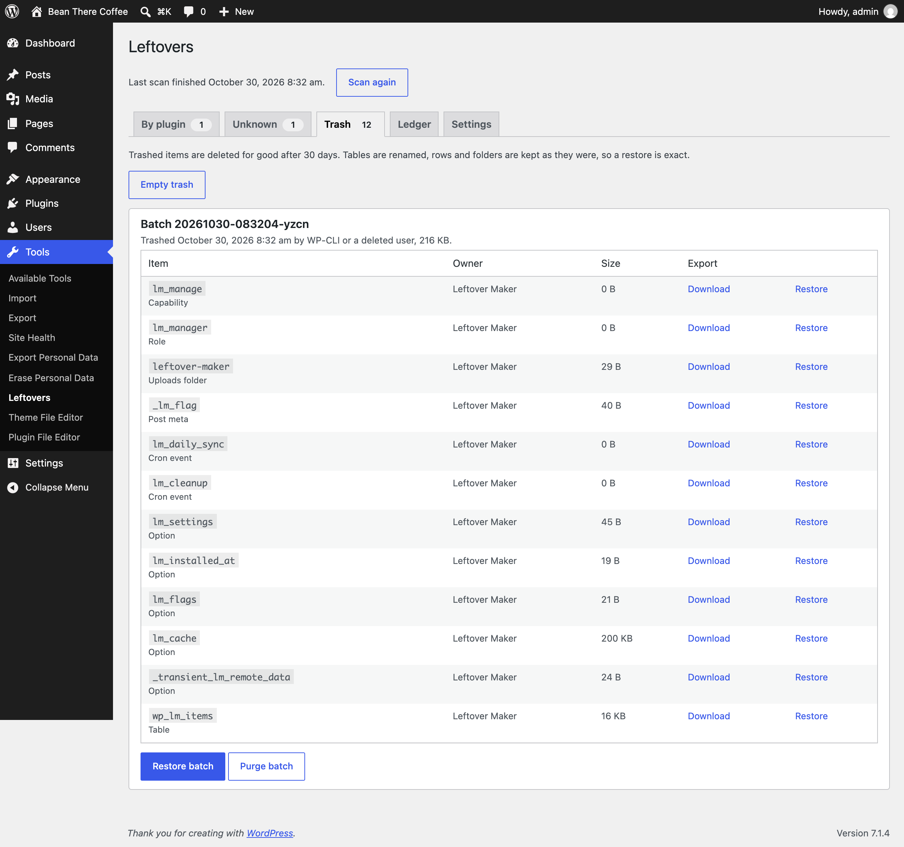
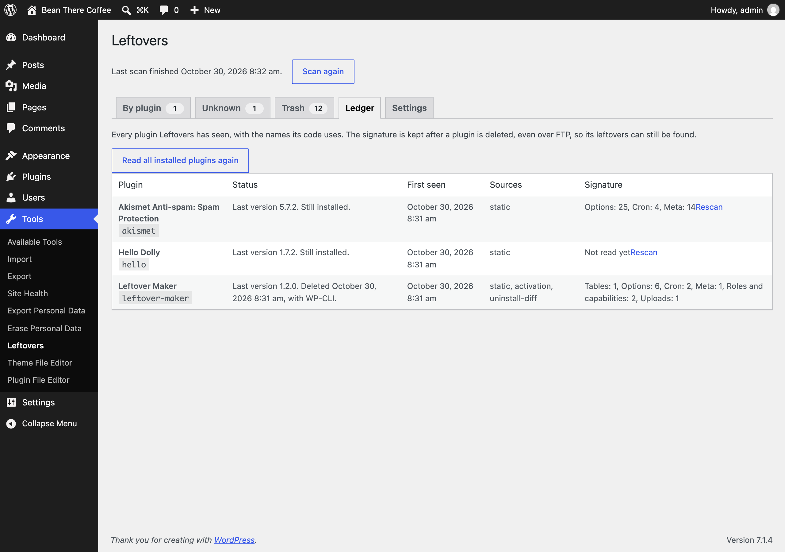
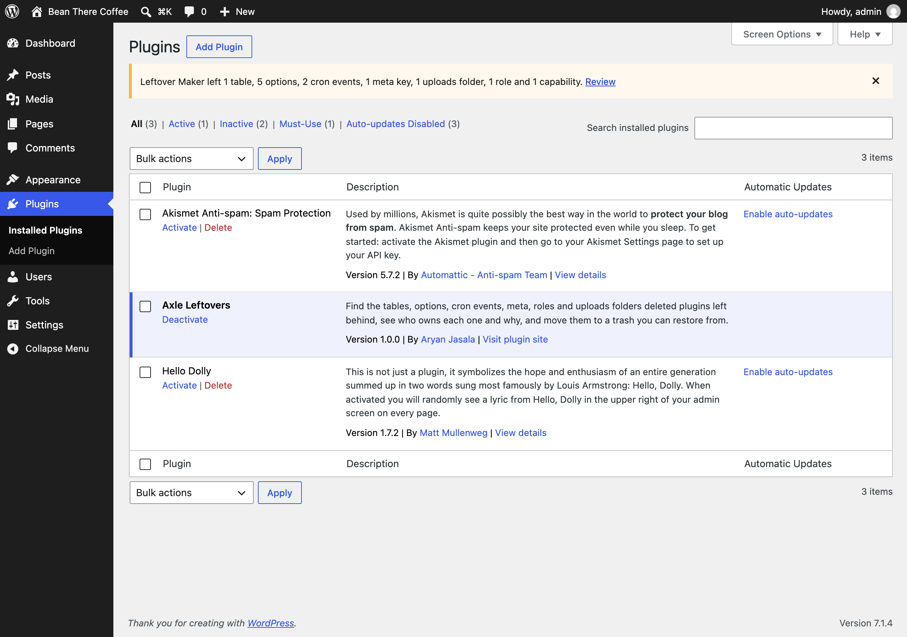

<p align="center"></p>

<h1 align="center">Axle Leftovers</h1>

<p align="center">
  <a href="https://playground.wordpress.net/?blueprint-url=https://raw.githubusercontent.com/aryanjasala/axle-leftovers/main/blueprint.json"></a>
  <a href="https://github.com/aryanjasala/axle-leftovers/releases/latest"></a>
  
  
  <a href="LICENSE.md"></a>
  <br>
  <a href="https://github.com/aryanjasala/axle-leftovers/actions/workflows/phpcs.yml"></a>
  <a href="https://github.com/aryanjasala/axle-leftovers/actions/workflows/phpstan.yml"></a>
  <a href="https://github.com/aryanjasala/axle-leftovers/actions/workflows/unit-tests.yml"></a>
  <a href="https://github.com/aryanjasala/axle-leftovers/actions/workflows/e2e-tests.yml"></a>
  <a href="https://github.com/aryanjasala/axle-leftovers/actions/workflows/plugin-check.yml"></a>
</p>

<p align="center">Find the tables, options, cron events, meta, roles and uploads folders deleted plugins left behind, see the evidence for each owner, and move them to a trash you can restore from.</p>

<p align="center">
  
</p>

---

Deleting a plugin runs its uninstall.php, if it has one. Many plugins have none, or skip tables, cron events, roles, uploads folders and meta. Cleaners list these, but they guess the owner or charge for it, and every delete is permanent. Axle Leftovers records who creates what, reads each plugin's code once, ships the names used by about 500 popular plugins, and shows the evidence for every owner. Nothing is deleted on the first step: items are exported, moved to a trash, and restored exactly with one click.

> [!NOTE]
> Free and open source under the GPL. No pro version, no upsells, no ads in wp-admin, no tracking. And it stays that way.
>
> Part of Axle by AryanX, a family of plugins for running WordPress sites safely.

## Features

- **Seven item types**: tables, options and transients, cron events, post, user, term and comment meta keys, uploads folders, roles, and capabilities on roles
- **Evidence, not guesses**: Certain (seen being created, around activation or at runtime), Likely (named in the plugin's code or the bundled dataset), Guess (name prefix), Unknown. Each item shows why
- **Nothing in use is listed**: data of installed plugins (active or not), must-use plugins, themes and core never shows up
- **Reference check**: a name that active code still uses blocks the trash and names the file
- **Trash with undo**: SQL or JSON export first, then tables renamed, rows and folders moved. Restore a batch or one item exactly, with autoload values and cron schedules
- **Typed confirmation** for Guess and Unknown items, on the screen, the CLI and the abilities
- **Cost**: rows, size and autoloaded bytes per item and per plugin, so you see what a deleted plugin still adds to every page load
- **Plugins screen notice** after a delete: "Leftover Maker left 1 table, 5 options and 2 cron events. Review."
- **Survives FTP deletes**: code signatures stay in the ledger, and plugins removed outside WordPress are recorded
- **WP-CLI**, REST, abilities for agents, Site Health, privacy export and erase, multisite, Axle Read-Only Mode aware

## Install

1. Download `axle-leftovers.zip` from the [latest release](https://github.com/aryanjasala/axle-leftovers/releases/latest).
2. In WordPress, go to **Plugins > Add New Plugin > Upload Plugin**, choose the zip and activate it.

Or with WP-CLI:

```sh
wp plugin install https://github.com/aryanjasala/axle-leftovers/releases/latest/download/axle-leftovers.zip --activate
```

Needs WordPress 6.6+ and PHP 7.4+. To try it first, the **Try in WordPress Playground** badge opens a throwaway WordPress in your browser with the plugin and some demo content.

## Quick look

See what deleted plugins left, then clean one up:

```sh
wp axle-leftovers scan
wp axle-leftovers list --plugin=contact-form-7
wp axle-leftovers trash --plugin=contact-form-7 --yes
wp axle-leftovers restore 20261030-101500-k3xq   # if it was wrong
wp axle-leftovers trash purge --older-than=30 --yes
```

Or open Tools > Leftovers.

## Screenshots

<table>
  <tr>
    <td width="50%" valign="top"><br><sub>By plugin: what a deleted plugin left, with the evidence, sizes, the autoload cost and the reference check</sub></td>
    <td width="50%" valign="top"><br><sub>Moving an Unknown table to the trash needs its name typed</sub></td>
  </tr>
  <tr>
    <td width="50%" valign="top"><br><sub>The trash: one batch, each item's export, and Restore</sub></td>
    <td width="50%" valign="top"><br><sub>The ledger: every plugin seen, how it was removed, and the names its code uses</sub></td>
  </tr>
  <tr>
    <td width="50%" valign="top"><br><sub>The notice on the Plugins screen after a delete</sub></td>
  </tr>
</table>

## Documentation

| Doc | What it covers |
| --- | --- |
| [Reference](docs/REFERENCE.md) | Item types, attribution and evidence, the dataset, hooks, abilities, REST, WP-CLI, data and privacy |
| [Development](docs/DEVELOPMENT.md) | Local setup, commands and tests |
| [Contributing](docs/CONTRIBUTING.md) | Pull requests, required checks and PR titles |
| [Releasing](docs/RELEASING.md) | How merged pull requests become releases |
| [Security](docs/SECURITY.md) | Reporting a vulnerability |
| [readme.txt](readme.txt) | What WordPress.org shows, with the FAQ and changelog |

## Project structure

```
axle-leftovers.php        plugin header, autoloader and owner_of()
src/
├── Plugin.php            creates the services
├── Recorder.php          who creates what: activation, runtime, uninstall
├── Ledger.php            plugins seen and first-seen items
├── Signature.php         reads a plugin's PHP for the names it uses
├── Dataset.php           the bundled signatures of popular plugins
├── Attribution.php       owner, confidence and evidence
├── References.php        is active code still using a name?
├── Scanner.php           the batched background scan
├── Trash.php             export, trash, restore, purge
├── Inventory.php         what exists right now
├── Storage.php           uploads/axle-leftovers with deny rules
├── Core.php              core and protected items
├── Settings.php          settings and filtered defaults
├── Schema.php            tables and schedules
├── Privacy.php           export, erase and policy text
├── Abilities.php         abilities for agents
├── Rest/Controller.php   REST routes
├── Admin/                Tools > Leftovers and the Plugins screen
├── Health/SiteHealth.php the Site Health test
└── Cli/                  wp axle-leftovers
bin/build-signatures.php  builds data/signatures.json at release time
data/signatures.json      the bundled dataset
assets/                   admin.css, admin.js
tests/
├── Unit/                 PHPUnit
└── e2e/                  Playwright specs, fixtures and the Docker site
.wordpress-org/           screenshots
docs/                     reference, development, contributing, releasing
```

## More free plugins

Small plugins that each fill one gap in WordPress, all free with no pro version:

| | Plugin | What it does |
| --- | --- | --- |
|  | [Page Template Usage](https://github.com/aryanjasala/page-template-usage) | See which template every page uses, and fix the pages on a missing template |
|  | [Staging Guard](https://github.com/aryanjasala/staging-guard) | Stops staging copies from emailing real people or getting indexed |
|  | [Category & Tag Trash](https://github.com/aryanjasala/category-tag-trash) | A trash for categories, tags and custom terms, with undo and full restore |
|  | [Axle Read-Only Mode](https://github.com/aryanjasala/axle-read-only-mode) | Read-only mode for WordPress during migrations and deploys |
|  | [Axle Block Restore](https://github.com/aryanjasala/axle-block-restore) | Restore a single block from an old revision, not the whole post |
|  | [Activity Log with Undo](https://github.com/aryanjasala/activity-log-with-undo) | An activity log where every change you can reverse has an Undo button |
|  | [Agent Governance](https://github.com/aryanjasala/agent-governance) | Hold risky AI agent calls for approval, preview what they change, and roll back a session |
|  | [Block Doctor](https://github.com/aryanjasala/block-doctor) | Scan the whole site for invalid and broken blocks and fix them in bulk, with undo |
|  | [Block Theme Ops](https://github.com/aryanjasala/block-theme-ops) | Find Site Editor changes that override your theme files, see the diff, reset them or send them to Git |
|  | [Role Right-Sizer](https://github.com/aryanjasala/role-right-sizer) | Recommends the smallest role each user needs, from what they actually do |
|  | [Update Rehearsal](https://github.com/aryanjasala/update-rehearsal) | Try plugin, theme, core and PHP updates on a disposable copy of your site in WordPress Playground first |
|  | [User Session Manager](https://github.com/aryanjasala/user-session-manager) | See every device signed in, sign out one, and limit sessions per role |

## License

Copyright Aryan Jasala. Licensed under [GPL-2.0-or-later](LICENSE.md).
